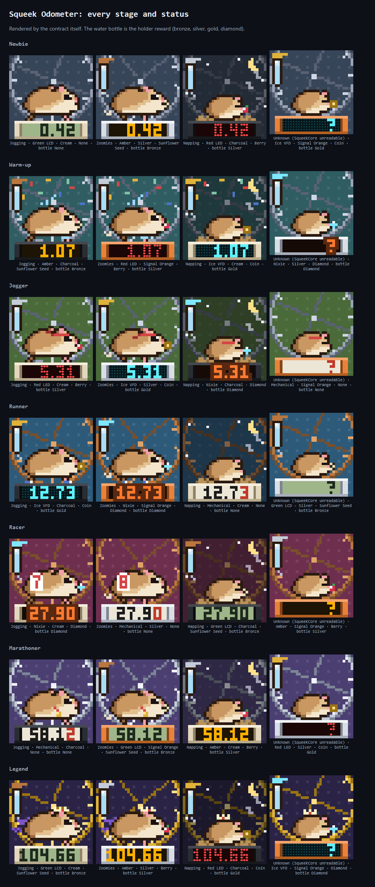
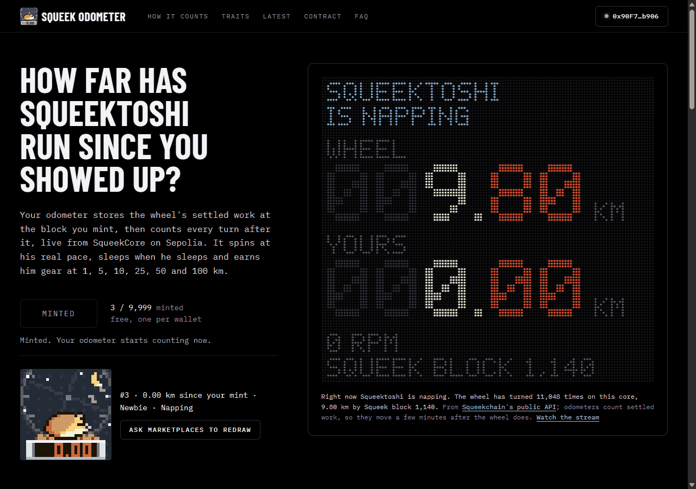

# Squeek Odometer

A free, fully on-chain odometer for **Squeektoshi**, the hamster whose wheel powers
[Squeekchain](https://squeekchain.com). Every token remembers the wheel's settled work at the moment it was minted
and shows how far he has run since, read live from SqueekCore on Sepolia (chain ID **11155111**). It naps when he naps,
gets the zoomies when he does, and earns gear as the kilometres add up. Squeek holders get a water bottle in the cage.

Built for the [Squeekchain Genesis Code Lane](https://squeekchain.com/genesis/code), in the "dynamic NFTs that
evolve with the hamster" category. This repository supplies the contract, tests, ABI export, deployment parameters,
review handoff and the static site. Testnet only. Not affiliated with Squeekchain.

There is no owner, admin, fee, payout, token, pool, randomness service, proxy or upgrade path. The mint is free and
plain ETH transfers revert.



## Imported launch handoff

The application, art, vendored libraries and static site come from
[`8a3615240715afb93f6f0eaa78c0018a7d4676f2`](https://github.com/am3en0x/squeek-odometer/tree/8a3615240715afb93f6f0eaa78c0018a7d4676f2).
`python3 tools/check_upstream.py` verifies the 327 imported files offline against [the provenance record](docs/UPSTREAM.json),
which holds the hash of each file as committed here and, under `adapted`, the upstream hash and the reason for every
file that differs. The adaptation adds adversarial tests, deployment rehearsals and review notes, removes the gallery's
EVM filesystem grants, makes that helper return data for a Python exporter, and pins the assignment's fuzz seed. The
vendored `lib/` sources were reformatted by `forge fmt`; their compiled code is unchanged. The upstream `launch.json`
is intentionally absent: the launch service's separate manifest step supplies it.

**Review revision (2026-11-06):** the independent review reopened the accepted import with three defects, which this
revision fixes in the contract and the art. The constructor no longer checks the chain id, because the launch
rehearses it from its factory on a chain that is not Sepolia and it reverted there. Every word copied from a
Squeekchain answer is now checked against the `uint64` its field declares: a non-canonical `state()` answer makes
`reading` and `tokenURI` degrade to *unknown* instead of overflowing, and `mint` refuses it with `CoreUnreadable`
instead of storing a baseline no real reading could ever exceed. The odometer screen pegs at 99,999 km instead of
underflowing its text origin, and its digits now start one column later so they sit on the screen for every width.
[REVIEW.md](docs/REVIEW.md) lists every finding with its disposition. Passing tests still do not replace the required
independent review, and no deployment or broadcast has been performed by this work.

## Build and verify

```sh
forge build
FOUNDRY_FUZZ_SEED=0x85fa591383f4e7b776f91b5633053b3d8132526e6370e1e924ac214f2266ba93 forge test
forge fmt --check
python3 tools/export_abi.py --check
python3 tools/check_upstream.py
python3 tools/export_gallery.py --check  # optional: reproduce all ten committed SVG assets
FOUNDRY_PROFILE=fork forge test     # optional: against the real Squeekchain contracts on Sepolia at a pinned block
```

`foundry.toml` pins Solidity **0.8.26**, Cancun, optimizer 200 runs and `bytecode_hash = "none"`. OpenZeppelin
Contracts 5.7.0 and forge-std 1.16.2 are vendored as plain files in `lib/` with their licenses: no submodules, no FFI,
no remote imports. Tests and helpers do not read wallet configuration or environment variables. The default tests use local mocks of SqueekCore, SqueekNFT and
SqueekStaking and need no RPC. Fuzz tests run 512 cases with the seed above pinned in `foundry.toml`. Stateful invariants run 128 sequences of
64 calls with unexpected reverts treated as failures. The fork profile needs a
Sepolia RPC (public by default). See [validation](docs/VALIDATION.md) for the recorded result, sizes and gas.

## Website (`dist/` static site)



The site is plain HTML, CSS and JavaScript with no build step, no framework and no libraries: `dist/` is the site and
is what gets pinned to IPFS. It reads Sepolia from the browser through the public RPC in `dist/config.js`; only the
mint and the optional redraw go through the visitor's wallet. The LED board in the first screen shows two odometers:
WHEEL, from [Squeekchain's public API](https://docs.squeekchain.com/developers/api/), and YOURS, from your token's
`tokenURI`. There is no server, indexer, key or analytics,
and the fonts are bundled (`dist/fonts/`, SIL OFL). Design tokens and components are in [DESIGN.md](DESIGN.md).

- The contract address and deployment block come from `dist/config.js`, or, when IMD hosts the site, from
  `imd-deployment.json` next to the page.
- `dist/samples/`, `dist/placeholder.svg` and `dist/favicon.svg` are the contract's own SVG, written by
  `python3 tools/export_gallery.py` (no EVM filesystem permissions). The committed assets remain unchanged.
- Serve it locally with `python3 -m http.server -d dist`.

## Contracts and deployment parameters

Deploy one contract in the launch's single factory transaction. The constructor is nonpayable, takes only static
arguments, makes no external calls and does not check the chain id: the launch rehearses it on an empty chain whose
id is not Sepolia's, and it must deploy there. What binds the token to Sepolia is the three addresses below.

| Contract | Constructor arguments in declaration order |
| --- | --- |
| `SqueekOdometer` | `core_ = 0xFD6C166D4B8E2962E65746a13e5a0797CD4dE0c4` (SqueekCore), `squeeks_ = 0xC4C7982657f00509548F3a3a41db7FA439a6856B` (SqueekNFT), `staking_ = 0x50fd1780526C3186A0c037c7622203bC4fb611ca` (SqueekStaking) |

The three addresses are Squeekchain's Sepolia release `core-sepolia-20261103`
([deployments](https://docs.squeekchain.com/developers/#deployments)) and are immutable. There is no `$owner` argument:
the contract has no privileged role. No initialization call, no funding, no launch token, distributor or pool.
The later manifest step must use exactly these three address arguments, zero value and no initialization call.
Runtime size is **23,398 bytes**, with **1,178 bytes** below EIP-170. The initcode is **24,082 bytes** before the
96 bytes of constructor arguments. The local CREATE2 rehearsal succeeds with dependencies absent. [IMD_JOB.md](docs/IMD_JOB.md) is the text for
the IMD launch request.

## Architecture and authorization

- **SqueekOdometer** (`src/SqueekOdometer.sol`): an OpenZeppelin 5 ERC-721 with ERC-4906. Stores per token only the
  SqueekCore work and the block time at mint; everything else is read on every `tokenURI` / `reading` call.
- **OdometerArt** (`src/art/OdometerArt.sol`) and **Sprites** (`src/art/Sprites.sol`): an internal library that turns a
  `Reading` into the SVG and the JSON. Pure functions, no storage.
- **ISqueek** (`src/interfaces/ISqueek.sol`): the three read-only Squeekchain interfaces it uses.

Who can do what:

- `mint()`: anyone, once per wallet (`idOf` remembers the wallet's token even after it is sent away), 9,999 in total,
  free. Acts for `msg.sender` only; uses `_mint`, so there is no receiver callback. Reverts if SqueekCore cannot be
  read, so every token starts from a real reading.
- `refresh(id)` and `refreshAll()`: anyone, free. They only emit ERC-4906 `MetadataUpdate` / `BatchMetadataUpdate`
  so marketplaces fetch the art again.
- Transfers and approvals: standard, unmodified OpenZeppelin.
- Nothing else writes. No owner, admin, pause, upgrade, payable function, `receive` or withdrawal.

Every Squeekchain read is a gas-capped `staticcall` that copies a fixed number of words and checks each word it uses
against the type its field declares (`uint64` for rounds, work and block height; a round page must start at ABI
offset 32). Reverts, short replies, gas exhaustion and out-of-range words degrade to unknown metadata or a missing
holder tier; mint fails if its starting read fails or is out of range. `tokenURI` is total over the whole `uint64`
work domain: the screen pegs at 99,999 km while the JSON keeps the exact distance. Values inside their ranges are
trusted as Squeekchain's data; they are not authenticated.
[Security handoff](docs/SECURITY.md) describes these limits, [ABI](docs/ABI.md) the client interface and [errors](docs/ERRORS.md) what each revert means.

## How a token reads the wheel

Everything is computed in `tokenURI` on every call; only the starting point is stored per token. Squeektoshi is drawn
by hand (a tan Syrian hamster in three fur shades, ears, eye light, pink paws) and framed close, with the top of his
wheel cropped off; each token is an odometer bolted to the wheel's base, and it is the odometer that varies from token
to token.

| What | How |
|---|---|
| Distance | SqueekCore `cumulativeWork` now minus at mint, × **887 mm**. One work unit is one accepted magnet passage, i.e. one wheel turn. The device estimates distance from a fixed wheel circumference; Squeekchain's API lifetime figures (22,789,368 mm over 25,701 units) give 886.7 mm, live speed/RPM readings about 880 mm. |
| Status | Work settled in the last three SqueekCore rounds (30 minutes, `roundPage`): none is **napping** (night falls, he curls up on his bedding, the wheel stops, z's float), under 1,500 is **jogging**, 1,500 or more is **zoomies** (ears pinned back, dust at his feet). If SqueekCore cannot be read, **unknown**. |
| Pace | The same work sets the animation speed: the wheel turns one way (three frames, never a crosshair) in 900 ms when he barely moves, 400 ms at the zoomies line, never faster than 240 ms. Motion is frame by frame (discrete SMIL), so pixels stay crisp; a viewer without SMIL shows the first frame. |
| Stage | Newbie, Warm-up at 1 km, Jogger 5, Runner 10, Racer 25, Marathoner 50, Legend 100. Each stage has one piece of gear (a wristband, a headband with a flapping knot, shoes, a race bib with the token's last digit, a medal, a cape on a clasp and a crown), its own background, and the wheel goes steel, bronze, silver, gold. Confetti for the first 300 m of a new stage; past 100 km a pip lights on the rim for every further 100 km. |
| Holder | If the owner holds a Squeek, his cage gets a water bottle whose cap and clip are bronze, silver (Squeek power of a Level 3 in staking), gold (Level 5) or diamond (Level 7). A Squeek only in the wallet counts as bronze. |
| The odometer (rolled at mint) | Display, each drawn its own way: Green LCD (dark digits on grey-green) 30%, Amber 25%, Red LED (a dot matrix) 18%, Ice VFD (over a dot grid) 15%, Nixie (with a glow) 9%, Mechanical (a light counter, last digit red) 3%. Casing: Cream 35%, Silver 30%, Charcoal 25%, Signal Orange 10%. Treat in his paws: none 45%, sunflower seed 30%, berry 15%, coin 8%, diamond 2%. |

Odometers count settled work only, so they move a few minutes after the wheel does. Marketplaces cache images, so
`refresh(id)` and `refreshAll()` ask them to fetch the art again.

## Art

A 40×40 pixel scene in SVG, drawn on chain. `tools/sprites.py` holds Squeektoshi (running, ears back, curled up
asleep, two leg frames), the wheel (clean midpoint circles, spokes and tread rungs in three frames), each stage's gear,
bedding, moon, stars and z's, dust, the water bottle, the pouch treats, confetti, the rim pips and a 3×5 font, and
writes them to `src/art/Sprites.sol` as run data; `src/art/OdometerArt.sol` turns each color group into one SVG path
through a write-once buffer, so a render costs linear gas.

```sh
# The sprite source and committed art are preserved; regeneration is not needed for this launch.
python3 tools/export_gallery.py                             # the contract's own SVG, returned to a local exporter
```

## After launch

1. **Independent reviewer and deployment service:** confirm the three Sepolia dependencies and their ABI layouts
   (both proxies can be upgraded by Squeekchain's timelock; see [REVIEW.md](docs/REVIEW.md)), deploy `SqueekOdometer`
   with the arguments above, verify the source on the explorer, and write the address and deployment block into
   `dist/config.js` (or ship `imd-deployment.json` next to the page).
2. **Site operator, if a site is requested separately:** populate the real deployed address and block, choose an RPC
   with sufficient `eth_call` gas, and host `dist/`. Site hosting is outside this contracts-only launch. The empty
   address in `dist/config.js` is an explicit pre-deployment placeholder, never a guessed contract address.
3. **Anyone:** mint once per wallet; call `refresh(id)` or `refreshAll()` when a marketplace shows a stale image.
4. **If Squeekchain redeploys SqueekCore:** existing tokens keep reading the old address. There is no owner to repoint
   them; a new deployment of this contract would be needed.

There are no owner-settable settings or post-launch configuration transactions. Nobody can repoint the immutable
dependencies or repair deployed code. Users pay Sepolia transaction gas; there is no mint price or maintenance keeper.
A dependency outage can stop new mints; recovery at the same address restores reads without an administrative action.
During an outage `tokenURI` still answers, with status *Unknown*, a "?" on the screen and zero distance (see
[SECURITY.md](docs/SECURITY.md)). Clients should handle RPC failures. Refresh events request cache invalidation;
marketplaces choose whether to honor them. The 9,999 cap is first come, first served per address, and addresses are
free: a token minted by a contract that cannot transfer it is stranded, and once the cap is reached nobody mints again.

## License

MIT. OpenZeppelin Contracts and forge-std keep their own licenses in `lib/`; IBM Plex Mono and Barlow Condensed in
`dist/fonts/` are under the SIL Open Font License 1.1.
